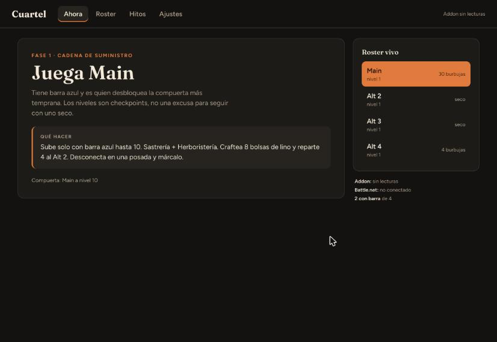

Conductor de la Horda para WoW Forever. Te dice a qué personaje jugar ahora según la barra azul y el blueprint de Ceedsy.

## Descargar

**[⬇ Última versión](https://github.com/josediego/cuartel-releases/releases/latest)**

| Sistema | Archivo |
| --- | --- |
| Windows | `.exe` (recomendado) o `.msi` |
| macOS (Apple Silicon) | `.dmg` |

> Los instaladores aún no están firmados. En Windows, SmartScreen mostrará "Windows protegió su PC": pulsa **Más información** y luego **Ejecutar de todas formas**.
> En macOS, Gatekeeper lo bloqueará la primera vez: clic derecho sobre la app, **Abrir**, y confirma.

## Instalar en 3 pasos

1. Abre Cuartel y sigue el onboarding: Battle.net (opcional), carpeta de WoW e **Instalar addon**.
2. Abre WoW y activa **Cuartel** en la lista de AddOns.
3. Escribe `/reload` en el juego.

## El addon

Lee tus personajes, niveles, quests y bolsas desde las SavedVariables de WoW. No usa red: nada sale de tu equipo. La app lo instala por ti; si prefieres hacerlo a mano, descarga `Cuartel-addon.zip` de la última release y descomprímelo en `Interface/AddOns/`.

## Se actualiza solo

Desde la 0.0.6 la app busca versiones nuevas y te avisa para actualizar con un clic.

## Problemas

En la app: **Ajustes → Diagnóstico → Reportar problema**. Se abre un issue en este repo con los datos prellenados, que revisas antes de enviar. También puedes abrirlo a mano en [Issues](https://github.com/josediego/cuartel-releases/issues).

## Créditos

- Blueprint de rutas: [Ceedsy](https://www.youtube.com/@ceedsy).
- Cuartel es un proyecto independiente, sin afiliación con Blizzard Entertainment.

---

Código fuente: privado por ahora.
